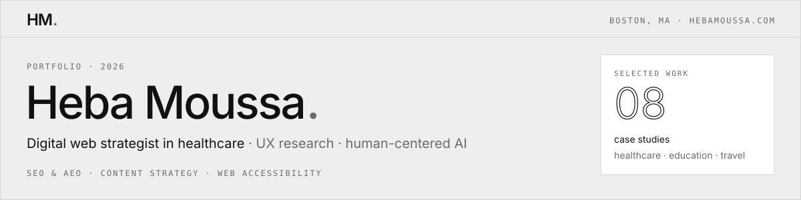
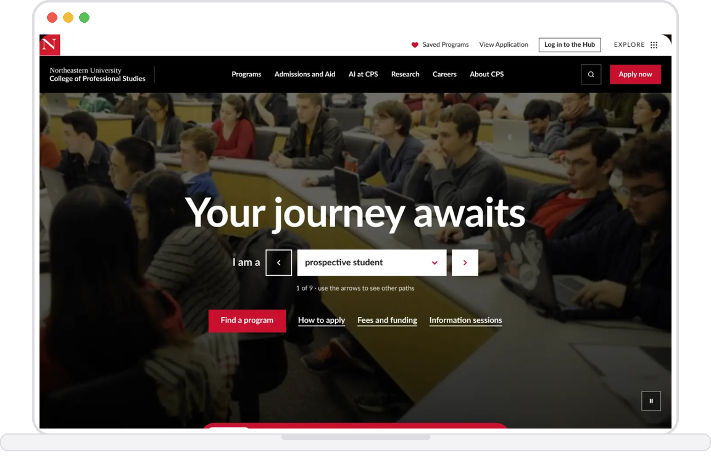
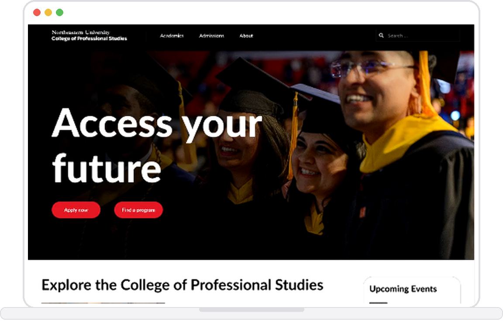
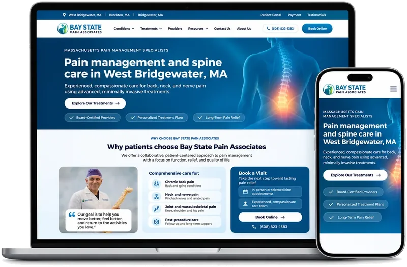
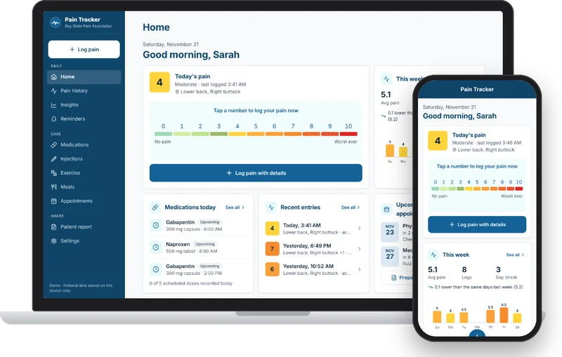
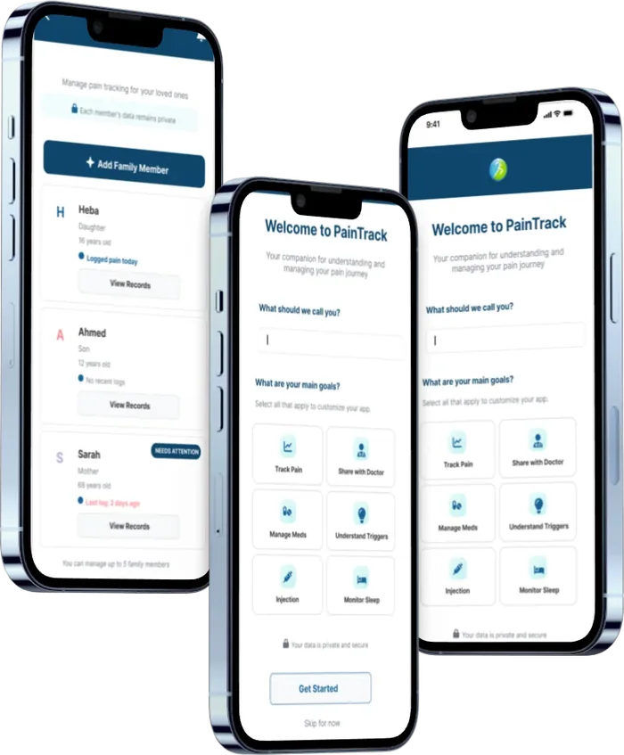
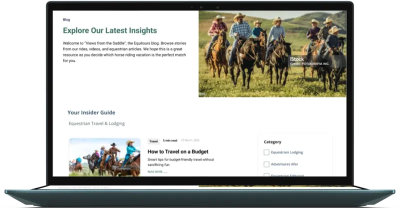
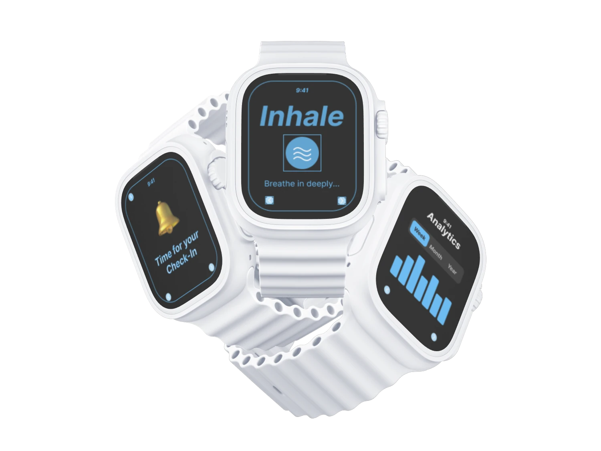
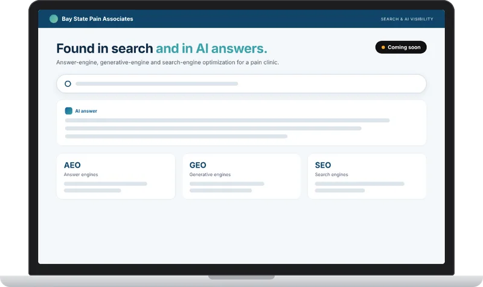

<!-- Text and tools come from hebamoussa.com. -->

<picture>
  <source media="(prefers-color-scheme: dark)" srcset="header-dark.svg">
  
</picture>

## Hello! I'm Heba Moussa.

I'm a Boston-based digital web strategist in healthcare (SEO and AEO, content strategy, web accessibility), researching human-centered AI in healthcare. I use UX research to make healthcare websites findable, accessible and clear, and I study how AI can keep the patient's voice.

- 🎓 MPS in Digital Media (Interactive Design) at Northeastern University
- 🔬 Research direction: **narrative fidelity**, patient-led repair of AI-generated chronic pain summaries
- 🩺 Focus: healthcare websites patients can find, trust and use, in Google and in AI answers
- 🌐 Portfolio: [hebamoussa.com](https://hebamoussa.com) · Reach me on [LinkedIn](https://www.linkedin.com/in/heba-moussa-mba/)

 

<code>01 — TOOLKIT</code>

## Tools I work with

**Designing**
 

**Research & data**
 

**Build, AI & workflow**
 

 

<code>02 — SELECTED WORK</code>

## Featured Projects

<table>
  <thead>
    <tr>
      <th width="30%">Project</th>
      <th>Description</th>
      <th width="22%">Tools &amp; tech</th>
    </tr>
  </thead>
  <tbody>
    <tr>
      <td>
         
        <a href="https://hebamoussa.com/work/cps-website-redesign-2026"><b>CPS Website Redesign 2026</b></a> 
        EDUCATION / UNIVERSITY WEBSITE
      </td>
      <td>Redesigning Northeastern's College of Professional Studies homepage so students, parents, alumni, faculty and staff can find what they need. Delivered an audience-first homepage, an insider guide, an Explore menu and a mobile prototype.  <b>Role</b> UX research &amp; design, solo · <b>Methods</b> Usability study, information architecture, mobile prototype</td>
      <td>
         
         
         
         
        
      </td>
    </tr>
    <tr>
      <td>
         
        <a href="https://hebamoussa.com/work/cps-website-redesign"><b>CPS Website Redesign 2025</b></a> 
        EDUCATION / UNIVERSITY WEBSITE
      </td>
      <td>Part one: an information architecture study of where students look for programs, dates and support, and a homepage that puts those first. Delivered research, a revised site map and a homepage prototype.  <b>Role</b> Team lead, with Sarah Gordon and Akanksha Kolungade · <b>Context</b> Winter 2025, DGM 6168</td>
      <td>
         
         
        
      </td>
    </tr>
    <tr>
      <td>
         
        <a href="https://hebamoussa.com/work/bay-state-pain-website"><b>Bay State Pain Website</b></a>  
        HEALTHCARE / CLINIC WEBSITE
      </td>
      <td>Patients were using the website, then picking up the phone. This is why, and what the site should do instead: a human-centered redesign of a pain clinic's website, built on what its patients said and tested with them.  <b>Role</b> UX researcher &amp; designer · <b>Methods</b> Benchmark, survey, interviews · <b>Context</b> DGM 6525, March 2026</td>
      <td>
         
         
         
         
         
         
        
      </td>
    </tr>
    <tr>
      <td>
         
        <a href="https://hebamoussa.com/work/bay-state-pain-tracker-app"><b>Bay State Pain Tracker app</b></a>  
        HEALTHCARE / WORKING APP
      </td>
      <td>The PainTrack prototype, rebuilt as a working app patients can install on a phone or use on a computer: pain log, medications, injections, reminders, insights and a PDF report. <a href="https://hebamoussa.com/pain-tracker/">Try the app ↗</a>  <b>Role</b> Product design and front-end direction · <b>Evidence</b> 108 automated browser checks; demo data, not yet tested with patients</td>
      <td>
         
         
         
         
         
         
         
        
      </td>
    </tr>
    <tr>
      <td>
         
        <a href="https://hebamoussa.com/work/bay-state-pain-app"><b>PainTrack</b></a> 
        HEALTHCARE / PATIENT APP
      </td>
      <td>An academic UX concept exploring how to reduce the effort of recording pain: a tracker designed for the middle of a flare-up, with little energy to spare. Testers found version 2 clearer; not yet tested with patients.  <b>Role</b> UX/UI design and research · <b>Methods</b> Usability testing, think-aloud, KJ synthesis, iterative prototyping</td>
      <td>
         
         
         
        
      </td>
    </tr>
    <tr>
      <td>
         
        <a href="https://hebamoussa.com/work/galloping-getaways"><b>Galloping Getaways</b></a> 
        TRAVEL / BOOKING WEBSITE
      </td>
      <td>A website redesign for a founder-led equestrian travel brand, built around how riders find, trust and book a riding holiday. Designed navigation and booking pathways to address browse-to-book friction.  <b>Role</b> UX research &amp; design, solo · <b>Context</b> DGM 6461 Interactive Info Design</td>
      <td>
         
         
         
         
        
      </td>
    </tr>
    <tr>
      <td>
         
        <a href="https://hebamoussa.com/work/stress-tracker"><b>Apple Watch Stress Tracker</b></a> 
        WEARABLES / APPLE WATCH APP
      </td>
      <td>Fast, glanceable stress tracking for Apple Watch: check in, breathe, reflect, understand. Designed for small-screen interactions. Prototype concept.  <b>Role</b> UX research &amp; design · <b>Methods</b> Interaction design, wearable UX, micro-interactions</td>
      <td>
         
         
         
        
      </td>
    </tr>
    <tr>
      <td>
         
        <b>AI search visibility</b>  
        HEALTHCARE / SEARCH &amp; AI VISIBILITY
      </td>
      <td>Making the clinic easy to find in Google and in AI answers: answer-engine, generative-engine and search-engine optimization. In progress.  <b>Role</b> Digital strategy</td>
      <td>
         
         
        
      </td>
    </tr>
  </tbody>
</table>

<a href="https://hebamoussa.com/work">See all case studies on hebamoussa.com ↗</a>

 

<code>03 — HIGHLIGHTS</code>

## Highlights

- Shipped a working, installable pain tracker from a classroom prototype, checked by 108 automated browser tests
- Redesigned a pain clinic's website from what its patients said, reaching Lighthouse accessibility 97 on mobile
- Led a three-person information architecture study of a university website, then continued it solo into a homepage redesign
- Research direction on **narrative fidelity**: whether an AI summary keeps the meaning, uncertainty and priorities of the patient it describes ([read more](https://hebamoussa.com/research))
- Writing on UX, accessibility and AI visibility in the [Journal](https://hebamoussa.com/journal)

 

<code>04 — CONTACT</code>

## Connect with me

Open to digital web strategy roles in healthcare and to collaborations in human-centered AI.
